# Validation status

Every COMSOL template is checked against an independent reference computed from the same case
file and the same material data (`python validation/validate.py <case>`). Only templates and cases
listed here are part of the public repository; the others are added once they pass.

COMSOL Multiphysics 6.4 on an Apple Mac mini (M4), no computing cluster. Gates: exact optical
references 2 %, R/T 0.01 (absolute), temperatures 2 %, energy budget 1 %. Approximate references
(MLWA, coupled dipoles, point-source superposition at gaps smaller than the radius) do not decide a
PASS: their deviation documents the approximation.

| Case | Template | Reference | Result | Status |
|---|---|---|---|---|
| `mim_s0` | PT_Multilayer | transfer matrix (Au 15 / SiO2 100 / Au 100 nm on glass, 450-900 nm, normal incidence) | max \|ΔR\| = 1.5e-05, max \|ΔT\| = 1.2e-07, layer absorption ≤ 2.6e-04, ∫Q_h vs 1−R−T: 7.2e-08 | **PASS** |
| `mim_s45` | PT_Multilayer | transfer matrix, 45°, s polarization | max \|ΔR\| = 3.2e-06, max \|ΔT\| = 2.3e-08, layer absorption ≤ 6.1e-06 | **PASS** |
| `mim_p45` | PT_Multilayer | transfer matrix, 45°, p polarization | max \|ΔR\| = 2.2e-03, max \|ΔT\| = 5.1e-03, layer absorption ≤ 2.4e-03 (field normal to the metal: same mesh, lower but in-gate accuracy) | **PASS** |
| `mim_device` | PT_Device | axisymmetric finite-volume solver (absorber on 1 mm glass, 0.2 W, w0 = 0.5 mm, 120 s on / 120 s off; stack 215 nm, ρ 11348, c_p 181, κ 168.6) | ΔT_max 118.60 K vs 118.87 K (-0.23 %); ΔT(t) within 0.23 % of the peak (±1 s around the edges excluded); budget residual 8.5e-07; lumped (single-τ) efficiency from the peak temperature η = 39, from the volume-averaged temperature η = 0.93 (true value 1) | **PASS** |
| `sphere_R20` | PT_Particle | Mie theory; ΔT = P/(4πκ)(1/R − 1/R_th) (Au, R = 20 nm, water, 450-700 nm) | σ_abs, σ_sca, σ_ext within 0.35 %, 0.18 %, 0.32 % of the peak; ΔT 26.63 K vs 26.61 K (+0.06 %) | **PASS** |
| `sphere_R50` | PT_Particle | Mie theory; ΔT = P/(4πκ)(1/R − 1/R_th) (Au, R = 50 nm, water, 450-850 nm (multipolar)) | σ_abs, σ_sca, σ_ext within 0.08 %, 0.17 %, 0.14 % of the peak; ΔT 53.98 K vs 53.94 K (+0.07 %) | **PASS** |
| `sphere_R20_kap` | PT_Particle | exact sphere with interfacial conductance, ΔT = P/(4πκ)(1/R − 1/R_th) + P/(4πR²G), G = 1e8 W/m²K | ΔT 34.64 K vs 34.62 K (+0.05 %), 8.0 K across the interface | **PASS** |
| `sphere_R20_nk` | PT_Particle | same as `sphere_R20`, Au read from a table | identical to `sphere_R20` | **PASS** (optics) |
| `rod_AR4` | PT_Particle | exact spheroid heat (gate); MLWA optics (approximate) | ΔT +0.25 %; FEM peak 804 nm (2 nm steps) vs MLWA 790 nm, peak height ratio 1.03 | **PASS** (heat); optics: information |
| `dimer_g20` | PT_Particle | coupled dipoles (approx.); point-source superposition (exact for gap ≥ R) | CDA extinction deviation 2.8 % of the peak; peak 540 vs 540 nm; heat superposition 0.9 % | **PASS** (heat) |
| `dimer_g10` | PT_Particle | coupled dipoles (approx.); point-source superposition (exact for gap ≥ R) | CDA extinction deviation 13.2 % of the peak; peak 550 vs 550 nm; heat superposition 1.8 % | information |
| `dimer_g05` | PT_Particle | coupled dipoles (approx.); point-source superposition (exact for gap ≥ R) | CDA extinction deviation 44.0 % of the peak; peak 570 vs 560 nm; heat superposition 2.6 % | information |
| `vesicle_N12` | PT_Particle | coupled dipoles, 3 incidences; superposition | extinction within 0.51 % for all incidences; ΔT_i within 0.84 % | **PASS** |
| `dimer_g02_gap` | PT_Particle | mesh planned for 16 GB (`ptpipe.mesh`, local gap sphere at gap/3); convergence probe (`_cA`, all sizes ×1.3); coupled dipoles (approx.) | 512,050 elements (planned 528,649), 2.94 M DOF, 10.5 GB in core, 115 s/λ (old uniform 1 nm mesh: 1.57 M elements, out of core, 2416 s/λ; σ_abs at 450 nm identical within 0.01 %); probes ×1.3 / ×1.6 vs planned 0.31 % / 0.46 %, monotone (extrapolation not meaningful: plateau); FEM peak 600 nm vs CDA 560 nm | **converged**; CDA: information |
| `jacs_patch_N19_g2` | PT_Particle | mesh planned for 16 GB (surface at gap/2); convergence probe; coupled dipoles, 3 incidences (approx.) | 495,784 elements (planned 523,186), 2.80 M DOF, 10.1 GB in core, 66 s/λ; probes ×1.3 / ×1.6 vs planned 0.23 % / 0.52 %, monotone, extrapolated planned-mesh error 0.38 %; CDA extinction deviation 10-22 % of the peak, peaks 550/560/520 vs 550/550/520 nm; superposition 14 % (gap < R: not a gate) | **converged**; CDA: information |

## Mesh planning (cost model)

`python -m ptpipe.mesh` estimates elements, DOFs, memory and time from the local mesh density and
plans the most accurate mesh that fits 60 % of the RAM. Fitted on the 11 PT_Particle runs above
(Apple M4, 16 GB): elements within -9 % / +13 %, memory within 0.8 GB for a given number of DOFs,
time within ~20 % (2 nm dimer: 115 s measured vs 57 s predicted, run with 6 cores at 10.5 GB).
Out-of-sample: the uniform-mesh 2 nm dimer is predicted at 1.46 M elements vs 1.57 M (-7 %).

## Figures

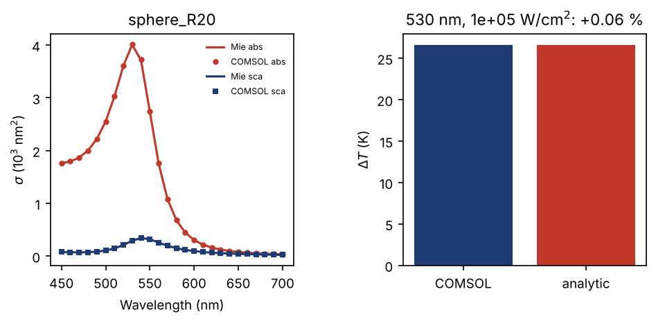
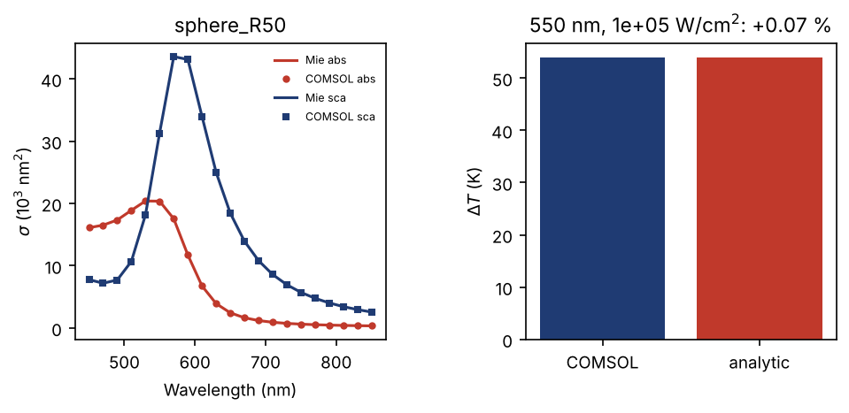
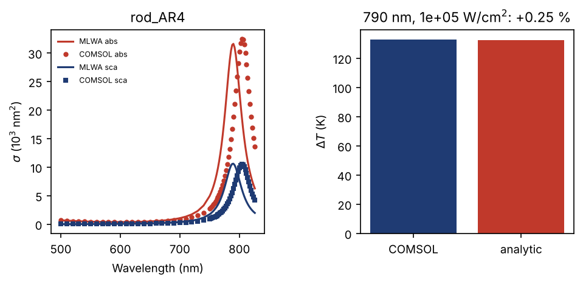
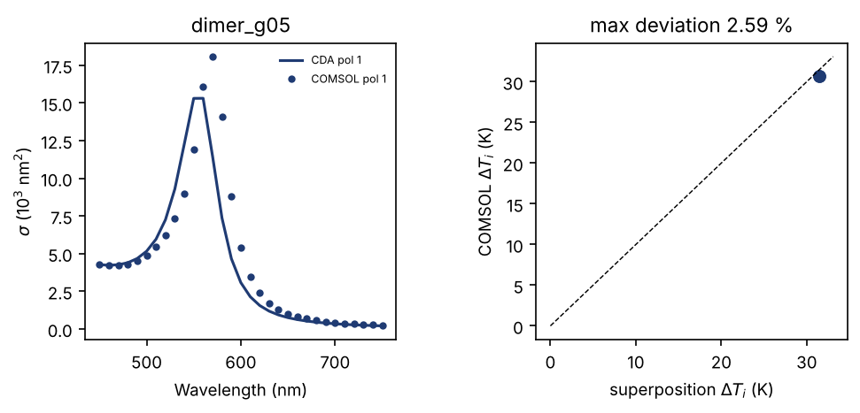
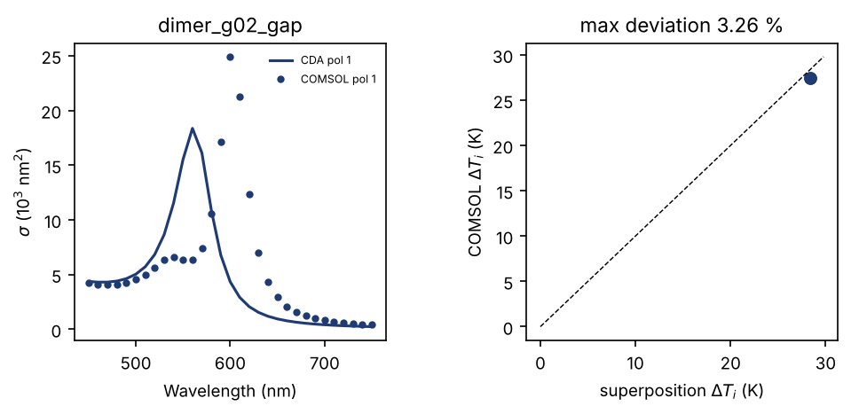
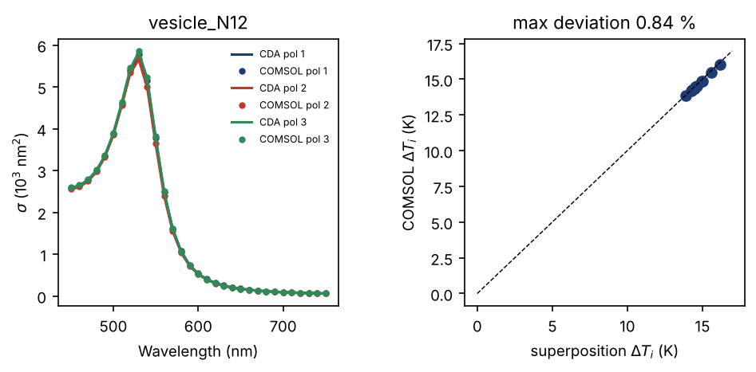
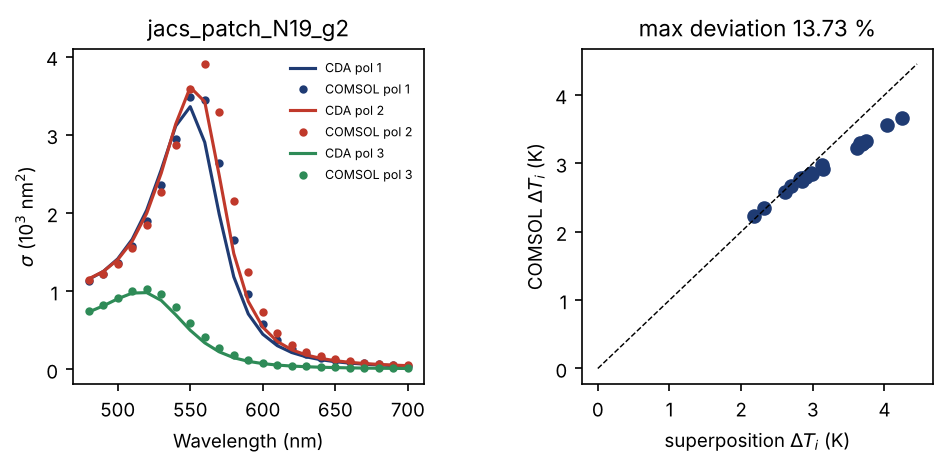
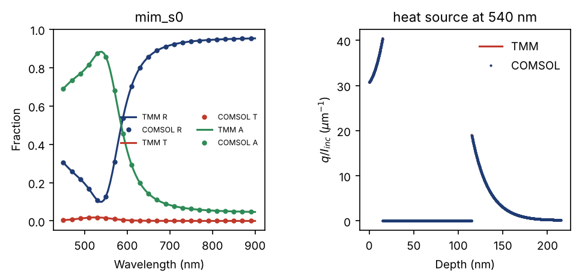
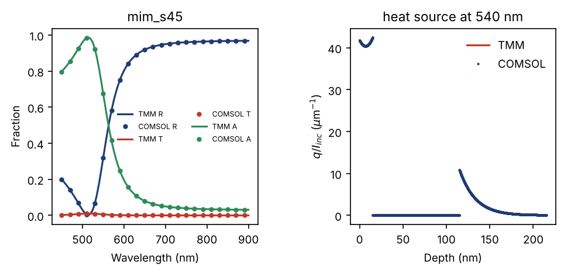
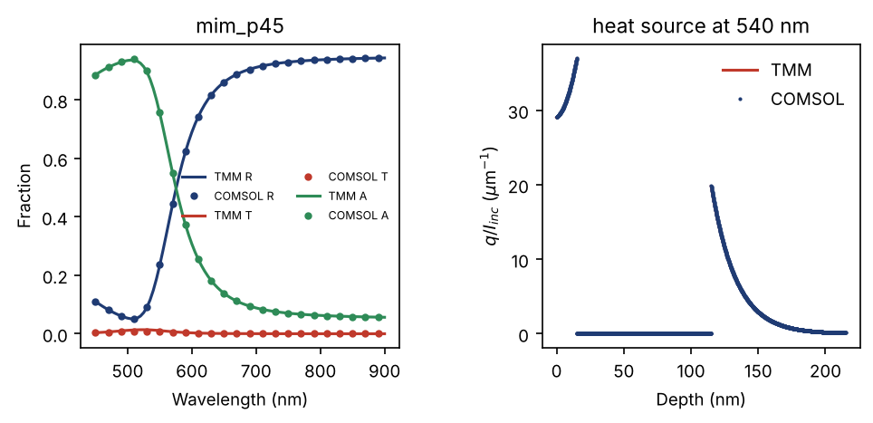
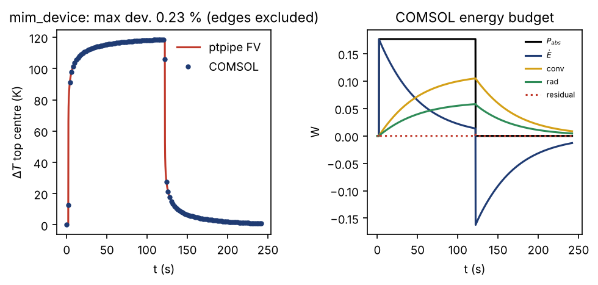

Field maps exported from the solved models (`bash run_validation.sh figures <cases>`, then
`python validation/plot_fields.py <cases>`):

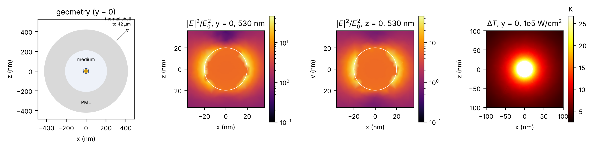
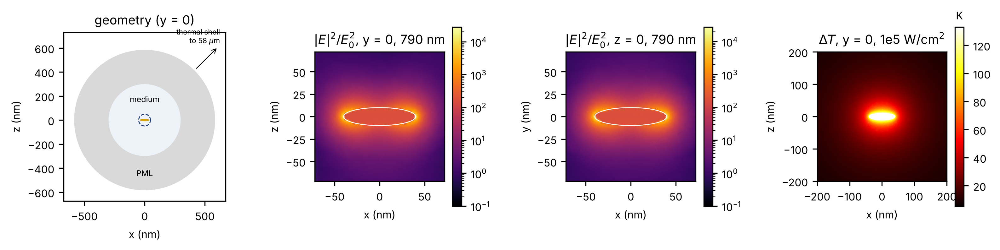
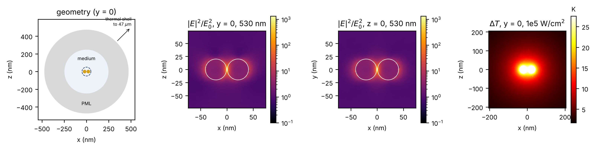
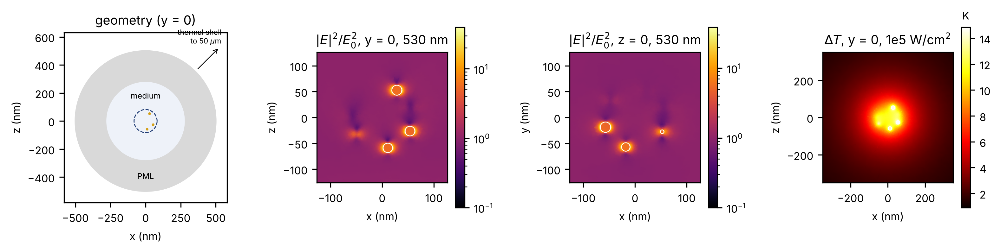
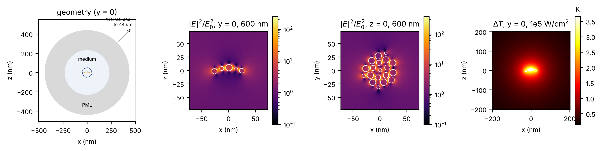

Not yet published: `jacs_patch_N19_g1` (1 nm gaps: needs ~15 GB at the accuracy floor, refused by
the planner on 16 GB; runs on a 32-64 GB machine), `dimer_g02` (uniform 1 nm mesh, out of core:
kept only as the reference for the cost model).
